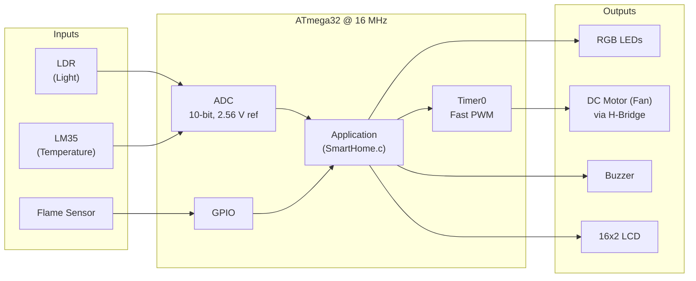
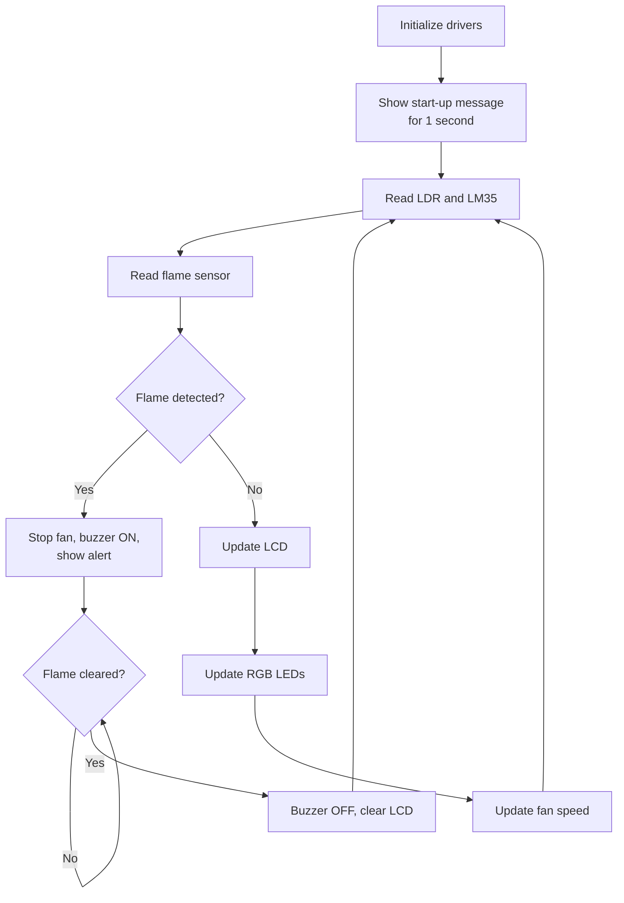

# Smart Home Automation System — ATmega32


An embedded smart home controller built on the **AVR ATmega32**. The system reads light,
temperature and flame sensors, then drives RGB lighting, a speed-controlled fan,
a buzzer alarm and a 16x2 LCD, all on bare-metal C with layered, reusable drivers.

---

## Table of Contents

- [Features](#features)
- [System Overview](#system-overview)
- [Hardware Components](#hardware-components)
- [Pin Configuration](#pin-configuration)
- [Wiring Details](#wiring-details)
- [System Behavior](#system-behavior)
- [Software Architecture](#software-architecture)
- [Project Structure](#project-structure)
- [Build and Flash](#build-and-flash)
- [Driver Configuration](#driver-configuration)

---

## Features

- **Automatic lighting**: 3 RGB LEDs react to the ambient light level measured by an LDR.
- **Automatic fan speed control**: the fan speed (PWM duty cycle) follows the room temperature from an LM35.
- **Fire alarm**: a flame sensor triggers a buzzer and an LCD alert, and stops the fan, with priority over all other tasks.
- **Live monitoring**: temperature, light intensity and fan status are shown on a 16x2 LCD.
- **Layered driver design**: MCAL drivers (GPIO, ADC, PWM) are separated from the hardware drivers (LCD, LM35, LDR, motor, ...), and the application uses only the driver APIs.

---

## System Overview



---

## Hardware Components

| Component | Qty | Purpose |
|---|:---:|---|
| ATmega32 microcontroller | 1 | Main controller |
| 16 MHz crystal + 2 x 22 pF capacitors | 1 | System clock |
| 16x2 character LCD (HD44780) | 1 | Display, 4-bit mode |
| LDR + fixed resistor (voltage divider) | 1 | Ambient light sensing |
| LM35 temperature sensor | 1 | Room temperature sensing |
| Flame sensor module (digital output) | 1 | Fire detection |
| RGB LEDs (or 3 LEDs) + current-limiting resistors | 3 | Lighting indication |
| DC motor | 1 | Fan |
| H-bridge motor driver (e.g. L293D) | 1 | Motor direction + PWM speed |
| Buzzer | 1 | Fire alarm |
| 100 nF capacitor | 1 | AREF decoupling for the internal 2.56 V reference |

---

## Pin Configuration

### Full pin map

| MCU Pin | Port.Bit | Direction | Connected To | Driver |
|:---:|:---:|:---:|---|---|
| 40 | **PA0** (ADC0) | Analog in | LDR voltage-divider output | `LDR.c` |
| 39 | **PA1** | Output | LCD **RS** | `lcd.c` |
| 38 | **PA2** | Output | LCD **E** (Enable) | `lcd.c` |
| 37 | **PA3** | Output | LCD **DB4** | `lcd.c` |
| 36 | **PA4** | Output | LCD **DB5** | `lcd.c` |
| 35 | **PA5** | Output | LCD **DB6** | `lcd.c` |
| 34 | **PA6** | Output | LCD **DB7** | `lcd.c` |
| 33 | **PA7** (ADC7) | Analog in | LM35 output (Vout) | `lm35_sensor.c` |
| 1 | **PB0** | Output | H-bridge **IN1** (motor direction) | `dc_motor.c` |
| 2 | **PB1** | Output | H-bridge **IN2** (motor direction) | `dc_motor.c` |
| 4 | **PB3** (OC0) | Output | H-bridge **EN** (PWM speed) | `pwm.c` |
| 6 | **PB5** | Output | **Red** LED | `LED.c` |
| 7 | **PB6** | Output | **Green** LED | `LED.c` |
| 8 | **PB7** | Output | **Blue** LED | `LED.c` |
| 16 | **PD2** | Input | Flame sensor **OUT** | `FlameSensor.c` |
| 20 | **PD6** | Output | Buzzer **+** terminal | `buzzer.c` |
| 21 | **PD7** | Output | Buzzer **-** terminal | `buzzer.c` |

### Power and clock pins

| MCU Pin | Name | Connection |
|:---:|---|---|
| 10 | VCC | +5 V |
| 11, 31 | GND | Ground |
| 30 | AVCC | +5 V (ADC supply) |
| 32 | AREF | 100 nF capacitor to GND (internal 2.56 V reference is used) |
| 12, 13 | XTAL2, XTAL1 | 16 MHz crystal, each pin with 22 pF to GND |
| 9 | RESET | 10 kΩ pull-up to +5 V |

---

## Wiring Details

### LCD (4-bit mode)

| LCD Pin | Signal | Connect To |
|:---:|---|---|
| 1 | VSS | GND |
| 2 | VDD | +5 V |
| 3 | V0 (contrast) | 10 kΩ potentiometer wiper |
| 4 | RS | PA1 |
| 5 | RW | GND (write only) |
| 6 | E | PA2 |
| 7–10 | DB0–DB3 | Not connected (4-bit mode) |
| 11 | DB4 | PA3 |
| 12 | DB5 | PA4 |
| 13 | DB6 | PA5 |
| 14 | DB7 | PA6 |
| 15, 16 | LED+ / LED- | Backlight (+5 V through a resistor / GND) |

### DC motor (L293D example)

| L293D Pin | Signal | Connect To |
|:---:|---|---|
| 1 | EN1 | PB3 (OC0, PWM) |
| 2 | IN1 | PB0 |
| 7 | IN2 | PB1 |
| 3, 6 | OUT1, OUT2 | Motor terminals |
| 8 | VS | Motor supply |
| 16 | VSS | +5 V logic supply |
| 4, 5, 12, 13 | GND | Ground |

| IN1 (PB0) | IN2 (PB1) | Motor State |
|:---:|:---:|---|
| 0 | 0 | Stop |
| 1 | 0 | Clockwise |
| 0 | 1 | Anticlockwise |

### Sensors

| Sensor | Pin | Connection |
|---|---|---|
| LM35 | VS / VOUT / GND | +5 V / PA7 (ADC7) / GND |
| LDR | Divider output | LDR and fixed resistor in series between +5 V and GND; the midpoint goes to PA0 |
| Flame sensor | VCC / GND / OUT | +5 V / GND / PD2 |

---

## System Behavior

### Lighting control (LDR)

| Light Intensity | Red | Green | Blue |
|:---:|:---:|:---:|:---:|
| 0 – 15 % | ON | ON | ON |
| 16 – 50 % | OFF | ON | OFF |
| 51 – 70 % | ON | OFF | OFF |
| > 70 % | OFF | OFF | OFF |

### Fan control (LM35)

| Temperature | Fan State | PWM Duty Cycle | LCD |
|:---:|:---:|:---:|---|
| ≥ 40 °C | ON | 100 % | `FAN IS ON` |
| 35 – 39 °C | ON | 75 % | `FAN IS ON` |
| 30 – 34 °C | ON | 50 % | `FAN IS ON` |
| 25 – 29 °C | ON | 25 % | `FAN IS ON` |
| < 25 °C | OFF | 0 % | `FAN IS OFF` |

### Fire alarm (flame sensor)

When the flame sensor output goes **HIGH**:

1. The fan stops immediately.
2. The buzzer turns on.
3. The LCD shows `Critical alert!`.
4. The system stays in alert mode until the flame is no longer detected, then returns to normal operation.

### LCD layout

```
+----------------+
|    FAN IS ON   |   Row 0: fan status
|TEMP=27 LDR=45 %|   Row 1: temperature (°C) and light intensity (%)
+----------------+
```

### Main loop



---

## Software Architecture

```
+-----------------------------------------------------------+
|                  Application  (SmartHome.c)                |
+-----------------------------------------------------------+
|  HAL:  LCD | LED | Buzzer | DC Motor | LM35 | LDR | Flame  |
+-----------------------------------------------------------+
|  MCAL:        GPIO        |       ADC       |     PWM      |
+-----------------------------------------------------------+
|                   ATmega32 Hardware                         |
+-----------------------------------------------------------+
```

| Layer | Module | Responsibility |
|---|---|---|
| MCAL | `gpio` | Pin/port direction, read and write |
| MCAL | `adc` | 10-bit ADC, configurable reference, prescaler, polling or interrupt mode |
| MCAL | `pwm` | Timer0 Fast PWM, non-inverting, F_CPU/8 |
| HAL | `lcd` | HD44780 LCD, configurable 4/8-bit mode and 2x16/4x16 size |
| HAL | `LED` | RGB LEDs, positive or negative logic selectable at compile time |
| HAL | `buzzer` | Buzzer on/off |
| HAL | `dc_motor` | Motor direction and speed |
| HAL | `lm35_sensor` | Temperature in °C |
| HAL | `LDR` | Light intensity in % |
| HAL | `FlameSensor` | Digital flame detection |
| Common | `std_types`, `common_macros`, `sensors_config` | Shared types, bit macros, sensor reference voltage |

---

## Project Structure

```
SMART_HOME/
├── SmartHome.c          # Application: main loop and control logic
│
├── gpio.c / gpio.h      # MCAL: GPIO driver
├── adc.c / adc.h        # MCAL: ADC driver
├── pwm.c / pwm.h        # MCAL: Timer0 PWM driver
│
├── lcd.c / lcd.h        # HAL: LCD driver
├── LED.c / LED.h        # HAL: RGB LED driver
├── buzzer.c / buzzer.h  # HAL: Buzzer driver
├── dc_motor.c / .h      # HAL: DC motor driver
├── lm35_sensor.c / .h   # HAL: LM35 temperature sensor
├── LDR.c / LDR.h        # HAL: LDR light sensor
├── FlameSensor.c / .h   # HAL: Flame sensor
│
├── std_types.h          # Common data types
├── common_macros.h      # Bit-manipulation macros
└── sensors_config.h     # Shared ADC reference voltage
```

---

## Build and Flash

**Requirements**

- Eclipse IDE for C/C++ with the AVR Eclipse plugin
- AVR-GCC toolchain (WinAVR)
- AVRDUDE and a programmer (for real hardware), or Proteus (for simulation)

**Project settings**

| Setting | Value |
|---|---|
| MCU | ATmega32 |
| CPU frequency (F_CPU) | 16000000 Hz |
| Optimization | -Os |

**Steps**

1. Import the project into Eclipse: *File → Import → Existing Projects into Workspace*.
2. Check *Project → Properties → AVR → Target Hardware*: **ATmega32**, **16000000 Hz**.
3. Build the project; the output `SMART_HOME.hex` is generated in the `Debug/` folder.
4. Flash the hex file with AVRDUDE, or load it into the ATmega32 in Proteus with the clock set to 16 MHz.

---

## Driver Configuration

Pins and options are defined as macros in the header files, so the hardware can be
re-mapped without changing any driver code:

| What to change | File | Macro(s) |
|---|---|---|
| LCD pins, data mode (4/8-bit), size | `lcd.h` | `LCD_RS_PIN_ID`, `LCD_E_PIN_ID`, `LCD_DB4..7_PIN_ID`, `LCD_DATA_BITS_MODE`, `LCD_ROWS` |
| LED pins and wiring logic | `LED.h` | `RED/GREEN/BLUE_LED_PIN_ID`, `LED_CONNECTION` |
| Buzzer pins | `buzzer.h` | `BUZZER_portID`, `BUZZER_positive_PinID`, `BUZZER_negative_PinID` |
| Flame sensor pin | `FlameSensor.h` | `FlameSensor_PORT_ID`, `FlameSensor_PIN_ID` |
| LM35 ADC channel | `lm35_sensor.h` | `SENSOR_CHANNEL_ID` |
| LDR ADC channel | `LDR.h` | `LDR_SENSOR_CHANNEL_ID` |
| ADC reference voltage | `sensors_config.h` | `ADC_REF_VOLT_VALUE` |
